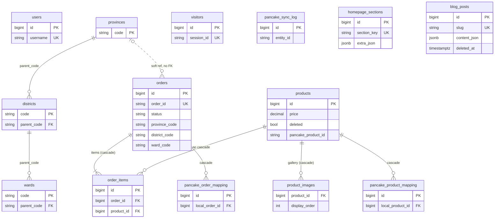

# Data model (service-api, PostgreSQL)
> Generated from 621a5a9 (2026-11-14) by project-onboard, including uncommitted working-tree changes (V16-V18, `HomepageSection`, `BlogPost`).
> This is a cache of the codebase, not a specification. Verify against code before relying on it, refresh with: "refresh docs/ai".

Đường dẫn rút gọn: `mig/` = `service-api/src/main/resources/db/migration/`, `ent/` = `service-api/src/main/java/com/dragun/ecommerce/model/entity/`, `pk/` = `service-api/src/main/java/com/dragun/ecommerce/integration/pancake/model/`, `res/` = `service-api/src/main/resources/`.

## Schema ownership
- Flyway là nguồn schema: `enabled: true`, `baseline-on-migrate: true` (`res/application.yml:34-37`). Head hiện tại: **V24** (`mig/V24__Add_order_customer_email.sql`).
- Hibernate `ddl-auto: validate` ở default và prod (`res/application.yml:27`, `res/application-prod.yml:11`), nhưng **`update` ở dev và test** kèm `flyway.validate-on-migrate: false` (`res/application-dev.yml:11-14`, `res/application-test.yml:11-14`). Hệ quả: DB dev/test có thể có cột/constraint do Hibernate tự thêm mà migration không có; luôn viết migration, đừng dựa vào `update` (inferred).
- `validate` chỉ kiểm tra tồn tại cột và kiểu, không kiểm tra NOT NULL / độ dài, nên các lệch ở mục Drift bên dưới không làm app fail khi khởi động (inferred).
- Kiểu thời gian: bảng cũ dùng `TIMESTAMP` không timezone + `LocalDateTime` (vd `mig/V1__Initial_schema.sql:8`, `ent/Order.java:71`); bảng CMS dùng `TIMESTAMPTZ` + `OffsetDateTime` (`mig/V16__Create_cms_tables.sql:15`, `ent/BlogPost.java:60`).
- Timestamp do app set trong `@PrePersist/@PreUpdate` (vd `ent/Product.java:105-124`), không có trigger DB.

## Tables

### users
`ent/User.java`, `mig/V1__Initial_schema.sql:2-10`
- `id BIGSERIAL PK`, `username VARCHAR(255) UNIQUE NOT NULL`, `password` (BCrypt), `email NOT NULL` (không unique), `role VARCHAR(50) DEFAULT 'ROLE_USER'` lưu string tự do (`ent/User.java:37-38`), không enum.
- Seed admin trong migration: V1:120-122, ghi đè hash ở V6:5-15 (`ON CONFLICT DO UPDATE`).

### products
`ent/Product.java`, `mig/V1__Initial_schema.sql:13-34` + V8, V9, V10, V11
- Tiền: `price DECIMAL(19,2) NOT NULL`, `old_price DECIMAL(19,2)` (`V1:16-17`) map `BigDecimal` (`ent/Product.java:28-32`). `rating DOUBLE PRECISION`, `discount INTEGER` (phần trăm, inferred).
- `name VARCHAR(1000)`, `main_image TEXT`, `category VARCHAR(255)`, `quantity VARCHAR(255)` sau V9 (`mig/V9__Extend_product_fields_length.sql:5-18`). `category` là string tự do (vd `'ME_DEN'` ở V4), không có bảng category.
- `quantity` là chuỗi mô tả quy cách ("1 lon x 500g"), không phải tồn kho; tồn kho là `stock INTEGER NOT NULL DEFAULT 0` (`V1:21-23`).
- Soft delete: `deleted BOOLEAN DEFAULT FALSE`, `status VARCHAR(20) DEFAULT 'ACTIVE'` (`mig/V10__Add_deleted_and_status_to_products.sql:3-4`); `priority INTEGER DEFAULT 999` (thấp = ưu tiên cao) (`mig/V11__Add_priority_to_products.sql:3`).
- Pancake: `pancake_product_id VARCHAR(100)`, `pancake_synced_at` (`mig/V8__Add_pancake_integration_tables.sql:4-6`).
- Index: `category` (V1:111), `deleted`, `status` (V10:12-13), `priority` (V11:11), `pancake_product_id` (V8:57).

### product_images (element collection)
`ent/Product.java:43-48`, `mig/V1__Initial_schema.sql:37-41` + V9, V14
- Không có PK. Cột: `product_id FK -> products ON DELETE CASCADE`, `image_url TEXT`, `display_order INTEGER DEFAULT 0` (`mig/V14__Add_display_order_to_product_images.sql:2-3`).
- Map bằng `@ElementCollection List<String> gallery` + `@OrderColumn(name = "display_order")`: Hibernate xoá và ghi lại toàn bộ list theo index 0..n-1 khi gallery đổi (inferred, hành vi chuẩn của `@OrderColumn`).
- Index `(product_id, display_order)` (V14:25-26).

### orders
`ent/Order.java`, `mig/V1__Initial_schema.sql:44-61` + V7, V8
- `id BIGSERIAL PK`; `order_id VARCHAR(50) UNIQUE NOT NULL` là mã đơn hiển thị cho khách (`V1:46`).
- Thông tin khách inline: `customer_name`, `customer_phone VARCHAR(20)`, `customer_address TEXT`; không FK sang `users` (đặt hàng không cần tài khoản, inferred).
- `province_code`, `district_code`, `ward_code VARCHAR(10)` (`V1:50-52`): **không có FK** sang bảng địa chính, chỉ là tham chiếu mềm.
- `status VARCHAR(50) NOT NULL DEFAULT 'pending'` (V1:53), xem mục Enums.
- Tiền: `sub_total`, `shipping_fee`, `total DECIMAL(19,2)` (`V1:55-57`, `ent/Order.java:55-62`). `payment_method`, `order_type` là string tự do.
- Pancake: `pancake_order_id`, `pancake_synced_at` (V8:10-11).
- `customer_email VARCHAR(255) NULL` (V24, task-005): email khách nhập ở checkout, nhận mail xác nhận đơn. Đơn cũ và đơn không nhập email là NULL.
- Index: `customer_phone`, `status`, `order_id` (V1:112-114), `pancake_order_id` (V8:58).

### order_items
`ent/OrderItem.java`, `mig/V1__Initial_schema.sql:64-73`
- `order_id FK -> orders ON DELETE CASCADE`, `product_id FK -> products` (không cascade), `quantity INTEGER`, `price DECIMAL(19,2)`, `product_name VARCHAR(255)` (snapshot tên tại thời điểm đặt).
- JPA: `Order.items` `@OneToMany(cascade = ALL, orphanRemoval = true)` (`ent/Order.java:67-68`).
- Vì FK `product_id` không cascade, xoá cứng product đã có đơn sẽ lỗi FK; đó là lý do product dùng soft delete (inferred).

### provinces / districts / wards
`ent/Province.java`, `ent/District.java`, `ent/Ward.java`, `mig/V1__Initial_schema.sql:76-108` + V2, V3
- PK tự nhiên `code VARCHAR(10)`. `districts.parent_code FK -> provinces.code`, `wards.parent_code FK -> districts.code`, đều có index (V1:115-116).
- JPA map `parentCode` (ghi được) và quan hệ `@ManyToOne` read-only (`insertable = false, updatable = false`) (`ent/District.java:40-47`, `ent/Ward.java:40-47`).
- Dữ liệu không nạp bằng migration mà bằng `LocationDataInitService` (`@PostConstruct`, chỉ khi bảng rỗng) từ `res/db/master/{province,districts,ward}.json` (`service/LocationDataInitService.java:32-61,70,89,116`).

### visitors
`ent/Visitor.java`, `mig/V13__Create_visitors_table.sql:2-14` + V15
- `session_id VARCHAR(255) NOT NULL`, **UNIQUE** `uk_visitors_session_id` từ V15 (`mig/V15__Fix_visitors_duplicate_session_id.sql:22-23`), thay index thường `idx_visitors_session_id` (V15:19). `ip_address VARCHAR(45)` (đủ cho IPv6), `visit_count INTEGER DEFAULT 1`.
- Index `first_visit_at`, `last_visit_at` (V13:20-23). Không có FK.

### pancake_product_mapping / pancake_order_mapping / pancake_sync_log
`pk/*.java`, `mig/V8__Add_pancake_integration_tables.sql:14-48`
- `pancake_product_mapping`: `local_product_id FK -> products ON DELETE CASCADE`, `pancake_product_id VARCHAR(100)`, `pancake_variation_id`, `UNIQUE(local_product_id, pancake_product_id)` (V8:14-24).
- `pancake_order_mapping`: `local_order_id FK -> orders ON DELETE CASCADE`, `UNIQUE(local_order_id, pancake_order_id)` (V8:27-36).
- `pancake_sync_log`: append-only log, `entity_type` (PRODUCT|ORDER|CUSTOMER), `sync_direction` (TO_PANCAKE|FROM_PANCAKE), `status` (SUCCESS|FAILED|PARTIAL) chỉ ghi trong comment, không có CHECK (V8:41-44, `pk/PancakeSyncLog.java:23-33`); `entity_id VARCHAR(100)` là id dạng chuỗi, không FK.
- Song song tồn tại cột `products.pancake_product_id` / `orders.pancake_order_id` và bảng mapping: hai nơi lưu cùng một liên kết (inferred: cột inline là bản denormalized).

### homepage_sections (CMS, chưa commit)
`ent/HomepageSection.java`, `mig/V16__Create_cms_tables.sql:3-17` + V18
- `section_key VARCHAR(64) UNIQUE NOT NULL` là khoá nghiệp vụ; seed có `hero`, `story`, `quality`, `meal_gallery`, `floating_chat`, `header_logo` (`res/cms-seed/homepage-sections.json`).
- `title`, `body TEXT`, `cta_text`, `cta_link`, `image_desktop`, `image_mobile VARCHAR(1000)`, `enabled BOOLEAN DEFAULT TRUE`, `sort_order INT DEFAULT 0`, `updated_at TIMESTAMPTZ`, `updated_by`.
- V19 thêm `page_key VARCHAR(32) NOT NULL DEFAULT 'home'` (home | story | philosophy) và đổi unique từ `section_key` sang `(page_key, section_key)` (`uq_homepage_sections_page_section`). Nội dung trang story/philosophy nằm hết trong `extra_json`, seed từ `cms-seed/page-sections.json`.
- V18 thêm `use_default_desktop`, `use_default_mobile BOOLEAN NOT NULL DEFAULT TRUE` (V18:3-5): `true` = dùng ảnh đóng gói sẵn ở frontend, path DB để `NULL`.
- `updated_at` được truncate về micro giây để dùng làm giá trị optimistic lock gửi cho admin (`ent/HomepageSection.java:72-76`). Không có `@Version`.
- Index `(enabled, sort_order)` (V16:47-48).

### blog_posts (CMS, chưa commit)
`ent/BlogPost.java`, `mig/V16__Create_cms_tables.sql:19-45`
- `slug VARCHAR(120) NOT NULL`, unique trong các bài chưa xoá (V20: bỏ `blog_posts_slug_key`, thêm partial index `uq_blog_posts_slug_active ... WHERE deleted_at IS NULL`), `title`, `excerpt TEXT NOT NULL`, `cover_image VARCHAR(1000)`, `content_json JSONB NOT NULL DEFAULT '[]'`.
- `status VARCHAR(20) DEFAULT 'DRAFT'` + `CHECK (status IN ('DRAFT','PUBLISHED'))` (V16:26,35); entity dùng `String`, không enum (`ent/BlogPost.java:44-45`).
- `show_on_home BOOLEAN`, `home_order INT` + `CHECK (home_order IS NULL OR home_order BETWEEN 1 AND 3)` (V16:36); partial unique index `uq_blog_home_order_active ON (home_order) WHERE show_on_home AND deleted_at IS NULL AND home_order IS NOT NULL` (V16:39-41). Service kiểm tra lại cùng luật (`service/BlogPostService.java:165,181`).
- Soft delete: `deleted_at TIMESTAMPTZ` (V16:30), set bởi `service/BlogPostService.java:152`; mọi query repo lọc `DeletedAtIsNull` (`repository/BlogPostRepository.java:11-34`).
- Optimistic lock thủ công bằng so sánh `updated_at` -> HTTP 409 (`service/BlogPostService.java:94-96`).
- Index partial `(status, published_at DESC) WHERE deleted_at IS NULL` (V16:43-45).

### customers (V22, task-003)
- Tài khoản khách, tách khỏi `users` (admin). `phone VARCHAR(10) UNIQUE` CHECK `^0[0-9]{9}$` (đã chuẩn hoá, là tên đăng nhập), `password_hash` (BCrypt), `full_name`, `email`, `birth_date`, `gender` CHECK `MALE|FEMALE|OTHER`, địa chỉ mặc định (`address_recipient`, `address_phone`, `address_line`, `province_code`, `district_code`, `ward_code`), `status` CHECK `ACTIVE|LOCKED|DELETED`, `phone_verified_at` (luôn NULL khi chưa có OTP), `must_change_password`, `token_version` (tăng khi đổi mật khẩu: access token cũ bị từ chối), `failed_login_count`, `locked_until`, `consent_at`, `consent_version`, `last_login_at`, `created_at`, `updated_at` (timestamptz, khoá lạc quan).

### customer_refresh_tokens (V22)
- `customer_id` FK `ON DELETE CASCADE`, `token_hash VARCHAR(64) UNIQUE` (SHA-256), `expires_at`, `revoked_at`, `user_agent`, `created_at`.

### product_reviews
- V21. `product_id BIGINT NOT NULL` FK `products(id) ON DELETE CASCADE`, `author_name VARCHAR(100)`, `rating SMALLINT` CHECK 1..5, `content TEXT`, `images JSONB` mảng ≤ 4 path (CHECK), `status` CHECK `PENDING|APPROVED|HIDDEN`, `source` CHECK `CUSTOMER|ADMIN|SEED`, `approved_at/by`, `created_at`, `updated_at/by`.
- V22 thêm `customer_id` FK `customers(id) ON DELETE SET NULL` (NULL với đánh giá khách vãng lai cũ, seed, admin) và unique index `(product_id, customer_id) WHERE customer_id IS NOT NULL`: một tài khoản một đánh giá mỗi sản phẩm.
- Index `(product_id, status, created_at DESC)` cho trang sản phẩm, `(status, created_at DESC)` cho admin.
- Không soft delete: ẩn bằng `HIDDEN`, DELETE là xoá hẳn. Optimistic lock bằng `updated_at` như CMS (`service/ProductReviewService.java` `requireFresh`).
- `products.review_count` không còn dùng để hiển thị; số đếm và điểm trung bình tính từ dòng `APPROVED`.

## Enums và cách lưu
| Enum / giá trị | Lưu như | Nguồn |
|---|---|---|
| `OrderStatus` (`ORDER_STATUS_PENDING`.. `ORDER_STATUS_CANCELLED`) | `VARCHAR` giá trị `PENDING`, `CONFIRMED`, `SHIPPING`, `DELIVERED`, `CANCELLED` qua `OrderStatusConverter` (`autoApply = true`) | `model/enums/OrderStatus.java:10-14`, `model/converter/OrderStatusConverter.java:11-28` |
| Đọc `OrderStatus` | khớp chính xác rồi fallback không phân biệt hoa thường; giá trị lạ trả `null` | `model/enums/OrderStatus.java:33-45` |
| `products.status` | string `ACTIVE` (default), không CHECK, không enum Java | `mig/V10__...sql:4`, `ent/Product.java:97-99` |
| `blog_posts.status` | string có CHECK DB `DRAFT`/`PUBLISHED` | `mig/V16__...sql:35` |
| `users.role` | string `ROLE_USER`/`ROLE_ADMIN` | `mig/V1__...sql:7,121` |
| Pancake `entity_type`, `sync_direction`, `status` | string, chỉ ghi chú | `mig/V8__...sql:41-44` |

Không dùng `@Enumerated` ở đâu cả; không có PostgreSQL enum type.

## Soft delete
- `products.deleted` boolean (`service/ProductService.java:159`), lọc thủ công bằng `findByDeletedFalse*` (`repository/ProductRepository.java:24-27`). Không có `@SQLRestriction`/`@Where`, nên `findAll`/`findById` vẫn trả bản ghi đã xoá.
- `blog_posts.deleted_at` timestamp, lọc thủ công trong mọi method repo.
- Bảng khác: xoá cứng.

## JSONB columns (shape ngầm định)
Cả hai map `@JdbcTypeCode(SqlTypes.JSON)`; DB không có ràng buộc shape.
- `homepage_sections.extra_json` (`Map<String,Object>`, `ent/HomepageSection.java:56-58`), shape theo `section_key` (từ seed + V18):
  - `quality`: `{ items: [{ icon: string|null, useDefaultIcon: bool, title, body }] }` (V18:50-73)
  - `meal_gallery`: `{ title, banner: string|null, useDefaultBanner: bool, tiles: [{ src: string|null, useDefault: bool, alt }] }` (V18:76-114)
  - `floating_chat`: `{ messengerUrl, zaloUrl }`
  - `hero`, `story`, `header_logo`: `{}`
- `page_key='story'` (trang /me), khối 9-11 thêm 2026-11-18 (seed `res/cms-seed/page-sections.json`, sort 9-11):
  - `ingredients`: `{ title, subtitle, tabs: [3 chuỗi], composition: { heading, items: [{ name, body }], note }, info: { heading, groups: [{ title, items: [string] }] }, facts: { heading, noteLabel, note, valueTitle, valueBody } }`
  - `products`: `{ title, subtitle, items: [{ name, body, tags: [string], productId: number|null, imageAlt, image: string|null, useDefaultImage: bool }], ctaTitle, ctaBody, ctaButton }` (tối đa 4 thẻ)
  - `gallery`: `{ title, items: [{ alt, image: string|null, useDefaultImage: bool }] }` (tối đa 12 ảnh). Ảnh mặc định theo vị trí: `FE/content/pageDefaults.js` `PAGE_DEFAULT_IMAGES.story`.
- `blog_posts.content_json` (`List<Map<String,Object>>`, `ent/BlogPost.java:40-42`): mảng block có `type`: `p {text, class?}`, `h2 {text}`, `img {src}`, `ul {items}`, `table {headers, rows}`, `cta {to, linkText, bold}` (`res/cms-seed/blog-posts.json`).

## Seed và data migrations
| Version | Loại | Tác động |
|---|---|---|
| V1, V6 | seed | tạo admin; V6 ghi đè password hash (`mig/V6__Fix_admin_password.sql:5-15`) |
| V2, V3 | schema fix có điều kiện | đổi `province_code`/`district_code` thành `parent_code` nếu DB cũ còn tên cũ (`mig/V2__...sql:4-42`) |
| V4 | seed | insert 5 product với **id tường minh** 1..5 + gallery, `ON CONFLICT (id) DO NOTHING` (`mig/V4__Insert_initial_products.sql:5-186`) |
| V5 | **rewrite PK** | `UPDATE products SET id = 5 WHERE id = 52`, sửa `order_items` theo (`mig/V5__Update_product_id_52_to_5.sql:7-18`) |
| V7 | rewrite giá trị | status đơn lowercase -> UPPERCASE (`mig/V7__Update_order_status_to_uppercase.sql:4-22`) |
| V10, V11 | backfill | set `deleted/status/priority` cho dòng NULL |
| V12 | rewrite giá trị | `quantity` "500g/lon" -> "1 lon x 500g" (`mig/V12__Fix_product_quantity_format.sql:5-36`) |
| V14 | backfill | `display_order` trích từ số trong tên file ảnh, còn lại 0 (`mig/V14__...sql:8-22`) |
| V15 | **xoá dữ liệu** | xoá visitor trùng `session_id`, giữ bản mới nhất (`mig/V15__...sql:4-17`) |
| V17 | marker | `SELECT 1`; seed thật do `CmsSeedService` (ApplicationRunner, idempotent theo `section_key`/`slug`) từ `res/cms-seed/*.json` (`service/CmsSeedService.java:36-44,57,103`) |
| V24 | thêm cột | `orders.customer_email` nullable, không backfill (`mig/V24__Add_order_customer_email.sql`) |
| V22 | tạo bảng + cột | `customers`, `customer_refresh_tokens`; `orders.customer_id` và `product_reviews.customer_id` (nullable, `ON DELETE SET NULL`) (`mig/V22__Create_customer_accounts.sql`) |
| V21 | tạo bảng + seed | `product_reviews`; chèn 5 đánh giá trước đây viết cứng trong `ProductDetail.vue` cho mọi sản phẩm hiện có (`source=SEED`, `APPROVED`, bỏ qua sản phẩm đã có dòng SEED) (`mig/V21__Create_product_reviews.sql`) |
| V20 | đổi constraint | slug unique chỉ trong bài chưa xoá (partial index), cho phép tạo lại slug của bài đã soft delete (`mig/V20__Blog_slug_unique_active_only.sql`) |
| V18 | rewrite giá trị + jsonb | xoá path ảnh đóng gói khỏi DB, bật cờ `use_default*`, sửa `extra_json` của `quality`, `meal_gallery` (`mig/V18__...sql:9-114`) |

## Drift entity vs migration, rủi ro
- `products.deleted`, `status`, `priority` nullable trong DB (V10:3-4, V11:3) nhưng entity `nullable = false` (`ent/Product.java:93-103`).
- `visitors.first_visit_at`, `last_visit_at`, `visit_count`, `created_at`, `updated_at` nullable trong DB (V13:9-13), entity `nullable = false` (`ent/Visitor.java:38-52`).
- `orders.status DEFAULT 'pending'` (V1:53) vẫn lowercase sau V7; insert SQL tay không set status sẽ ra giá trị lệch chuẩn (converter vẫn đọc được nhờ fallback).
- `orders.order_id` DB `VARCHAR(50)`, entity không khai `length` (255) (`ent/Order.java:27`); `customer_phone` DB 20 vs entity 255. `validate` không bắt.
- `product_images` không có PK và `display_order` không unique; V14 cho ảnh black/pink bắt đầu từ 1 và ảnh không khớp regex đều = 0, nên với `@OrderColumn` list có thể có phần tử `null` ở index 0 hoặc ghi đè lẫn nhau cho tới lần lưu gallery kế tiếp (inferred).
- V4 insert id tường minh mà không `setval` sequence: trên DB mới, lần tạo product đầu tiên qua JPA có thể đụng PK id 1 (inferred, kiểm tra `products_id_seq`).
- `blog_posts.slug`: từ V20 unique chỉ trong bài chưa xoá, khớp kiểm tra của `BlogPostService`; entity không khai `unique = true` vì `ddl-auto: update` (dev) sẽ tạo lại constraint toàn bảng. Seed bỏ qua cả slug đã soft delete (`existsBySlug`) để bài admin đã xoá không sống lại, và `CmsSeedService.run` không còn `@Transactional`: mỗi bản ghi tự commit, lỗi của một bản ghi chỉ bị log và bỏ qua. Vi phạm constraint còn lại trả 409 qua `GlobalExceptionHandler` (không lộ text SQL).
- V1:118-119 ghi mật khẩu admin dạng plaintext trong comment migration.

## Index: thiếu và thừa
- Thiếu index FK: `order_items.order_id`, `order_items.product_id` (V1:64-73). Các FK khác đều có index (V1:115-116, V8:51-54, V14:25).
- Thừa: `idx_orders_order_id` (V1:114) trùng unique constraint `V1:46`; `idx_pancake_product_mapping_local`, `idx_pancake_order_mapping_local` (V8:51,53) trùng cột đầu của unique composite.

## ER diagram

