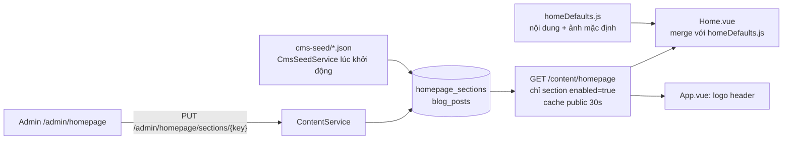

# CMS trang chủ: phân tích hiện trạng và spec cải tiến

> Tài liệu làm việc (01-wip). Phần 1 và 2 rút từ đọc code (chưa chạy thử runtime). Phần 3 trở đi là
> đề xuất, mặc định `[PROPOSED]` cho đến khi owner chốt. Khi chốt, tách sang `03-business/business-rules.md`,
> `04-system/srs.md`, `05-design/{apis,screens,data-model}` qua đúng skill sở hữu.

## 1. Hiện trạng (as-is)

### 1.1 Luồng dữ liệu

### 1.2 Mô hình dữ liệu

- `homepage_sections`: 1 dòng / section, khoá `section_key` cố định 6 giá trị: `header_logo`, `hero`, `story`, `quality`, `meal_gallery`, `floating_chat` (`ContentService.SECTION_KEYS`).
  - Cột chung: `title`, `body`, `cta_text`, `cta_link`, `image_desktop`, `image_mobile`, `use_default_desktop/mobile`, `enabled`, `sort_order`, `updated_at`, `updated_by`.
  - Dữ liệu riêng từng section nằm trong `extra_json` (jsonb, không có schema): `quality.items[2]`, `meal_gallery.{title,banner,tiles[4]}`, `floating_chat.{messengerUrl,zaloUrl}`.
- Ảnh có 3 trạng thái: `useDefault=true` (ảnh đóng gói trong FE) / `false + path` (ảnh admin upload) / `false + rỗng` (để trống).
- `blog_posts`: `status` DRAFT|PUBLISHED, `show_on_home` + `home_order` 1..3 (unique index khi đang hiện home), soft delete.

### 1.3 Admin

- 1 màn `/admin/homepage`: tab theo section, mỗi tab 1 form, nút "Lưu section" ghi thẳng vào bản đang chạy.
- Ảnh qua `CmsImageUploader` + `POST /admin/files/upload-cms` (kiểm slot, tỷ lệ, kích thước tối thiểu theo `ImageSlot`).
- Blog: `/admin/blog` list + editor block (`p`, `h2`, `ul`, `img`, `cta`, `table`), tick "Hiện trên Home" + chọn thứ tự 1..3.
- Optimistic lock bằng `updatedAt` (409 khi lệch).

### 1.4 Public Home (`Home.vue`)

Thứ tự render cố định trong template: hero, story, **sản phẩm bán chạy (hardcode)**, quality, meal_gallery, **bài viết nổi bật (tiêu đề hardcode)**, nút chat nổi.

## 2. Vấn đề phát hiện

Xếp theo mức ảnh hưởng tới mục tiêu "admin sửa gì thì user thấy đúng như thế".

| # | Mức | Vấn đề | Bằng chứng (code) |
|---|---|---|---|
| 1 | Cao (bug) | **Tắt "Hiển thị" một section trong admin nhưng Home vẫn hiện.** API public bỏ section disabled khỏi response; Home merge `{...defaultHomepage.sections, ...data.sections}` nên section thiếu được lấp bằng bản mặc định có `enabled: true`. | `ContentService.getPublicHomepage` (findByEnabledTrue), `Home.vue` `fetchHomepageContent`, `homeDefaults.js` |
| 2 | Cao (bug) [INFERRED] | **Lưu section lần 2 liên tiếp (không tải lại) có thể bị 409 "đã được cập nhật bởi người khác".** Service đặt `updatedAt=T1` rồi trả response, nhưng `@PreUpdate touch()` chạy lúc flush (commit) ghi `T2` vào DB. Admin giữ T1, lần lưu sau so với T2. Cần chạy thử để xác nhận. | `ContentService.updateSection`, `HomepageSection.touch()` |
| 3 | Cao | **`sort_order` không có tác dụng.** Admin không có UI sắp xếp; Home render theo thứ tự template cố định, bỏ qua `sortOrder`. | `AdminHomepage.vue`, `Home.vue` template |
| 4 | Cao | **Khối "Sản phẩm bán chạy" và "Bài viết nổi bật" không quản lý được**: tiêu đề hardcode, không bật/tắt, không đổi vị trí. | `Home.vue` dòng ~23, ~192 |
| 5 | Cao | **Không có nháp / xem trước / hoàn tác.** Bấm Lưu là lên production ngay (sau tối đa 30s cache), không preview, không lịch sử để rollback khi sửa nhầm. | `AdminHomepageController`, `ContentController` |
| 6 | Trung bình | **Mất dữ liệu đang sửa khi chuyển tab**: dữ liệu `extra_json` (quality, gallery, chat) được dựng lại từ server mỗi lần đổi tab; không có cảnh báo "chưa lưu". | `AdminHomepage.vue` `watch(activeKey, syncExtrasFromActive)` |
| 7 | Trung bình | **Bỏ hết bài nổi bật nhưng Home vẫn hiện 3 bài mặc định** (blog1..3 trong code FE), có thể trỏ tới slug không còn. | `Home.vue` chỉ thay khi `featuredPosts.length > 0` |
| 8 | Trung bình | **Luật bài nổi bật chưa chặt**: bài DRAFT vẫn được tick "Hiện Home" và chiếm slot (đếm cả draft, nhưng public chỉ lấy PUBLISHED, nên Home hiện thiếu bài); chuyển DRAFT qua PUT không gỡ khỏi Home (chỉ PATCH status gỡ); 2 admin cùng chọn 1 slot sẽ đụng unique index, ra lỗi 500 thay vì thông báo rõ. | `BlogPostService.applyHomeRules`, `update`, `updateStatus` |
| 9 | Trung bình | **Số phần tử cố định**: quality đúng 2, gallery đúng 4; icon mặc định gán theo vị trí. Muốn thêm chứng nhận thứ 3 phải sửa code. | `ContentService.validateExtraJson` |
| 10 | Trung bình | **Hero thiếu nội dung marketing**: không có link khi bấm banner (đang mở modal phóng ảnh), không alt text, không nhiều slide / lịch chạy. Story lưu `useDefaultMobile` nhưng không có ảnh mobile. | `Home.vue` hero, `AdminHomepage.vue` |
| 11 | Trung bình | **Link không được kiểm tra**: `ctaLink`, `messengerUrl`, `zaloUrl` nhận chuỗi bất kỳ (kể cả `javascript:`), seed để placeholder `yourpage`. | `ContentService.validateExtraJson` (floating_chat bỏ trống) |
| 12 | Thấp | Ảnh thay thế không bị dọn (file mồ côi), không có thư viện ảnh để tái sử dụng. | `CmsImageService` |
| 13 | Thấp | Admin không biết thay đổi mất tới 30s mới thấy trên Home (cache public). | `ContentController` |
| 14 | Thấp | `extra_json` không có schema: FE và BE mỗi bên tự hiểu cấu trúc, dễ lệch khi thêm section. | `ContentService`, `AdminHomepage.vue`, `Home.vue` |

## 3. Nguyên tắc thiết kế [PROPOSED]

1. **Một nguồn sự thật**: Home chỉ hiển thị những gì API trả về. Giá trị mặc định chỉ dùng cho ảnh khi `useDefault=true`, và khi API lỗi thì dùng bản tốt gần nhất, không bao giờ "bật lại" section admin đã tắt.
2. **Admin thấy đúng cái user sẽ thấy**: thứ tự, bật/tắt, thiết bị hiển thị trên admin khớp 1-1 với Home; có preview desktop/mobile trước khi xuất bản.
3. **Nháp tách khỏi bản đang chạy**: sửa thoải mái ở nháp, bấm "Xuất bản" mới lên Home; mỗi lần xuất bản là 1 phiên bản, hoàn tác được.
4. **Schema theo loại section**: mỗi loại section khai báo trường, ràng buộc, slot ảnh một lần; form admin, validate BE và component Home cùng dựa vào đó.
5. **Lỗi nói tiếng người**: mọi vi phạm ràng buộc trả 400/409 có thông điệp rõ, không 500.

## 4. Spec đề xuất [PROPOSED]

### 4.1 Mô hình nội dung

- **Section type** (khai báo trong code, cả BE và FE): `header_logo`, `hero`, `story`, `product_showcase` (mới), `quality`, `meal_gallery`, `featured_posts` (mới), `floating_chat`. Mỗi type có:
  - `schema`: danh sách trường (text, textarea, link, image slot, list có min/max phần tử).
  - `placement`: `layout` (nằm trong danh sách kéo thả của trang) hoặc `global` (logo, chat nổi: không sắp xếp được, luôn ở vị trí cố định).
- **Section instance**: giữ `section_key` hiện tại (1 instance / type ở giai đoạn này; thiết kế cho phép nhiều instance sau này, vd 2 khối banner).
- Trạng thái hiển thị mỗi section: `enabled`, `visible_on` (`all` | `desktop` | `mobile`), tuỳ chọn `start_at` / `end_at` (giai đoạn 3).
- Nội dung chia 2 bản: `draft_content` (admin đang sửa) và `published_content` (user đang thấy).

### 4.2 Thay đổi dữ liệu (hướng, chi tiết để `data-model`)

- `homepage_sections`: thêm `section_type`, `draft_content jsonb`, `published_content jsonb`, `visible_on`, `start_at`, `end_at`, `has_unpublished_changes` (hoặc so sánh 2 bản), `version int`. Các cột rời hiện tại (`title`, `body`, ảnh...) chuyển vào content json theo schema (migration chuyển dữ liệu, giữ cờ `useDefault`).
- `homepage_layout` (hoặc giữ `sort_order` + `enabled` trên section, có bản draft/published): thứ tự và bật/tắt cũng phải qua nháp rồi mới xuất bản.
- `homepage_revisions`: ảnh chụp toàn bộ trang (layout + nội dung mọi section) mỗi lần xuất bản: `id`, `snapshot jsonb`, `published_at`, `published_by`, `note`.
- `blog_posts`: giữ nguyên, siết luật ở 4.6.

### 4.3 Quy tắc nghiệp vụ

1. Lưu ở admin chỉ ghi vào nháp; Home không đổi cho đến khi "Xuất bản".
2. Xuất bản áp dụng **cả trang một lần** (layout + mọi section có thay đổi), tạo 1 revision, xoá cache public.
3. Hoàn tác: chọn 1 revision, nạp vào nháp, admin xem trước rồi xuất bản lại (không ghi đè thẳng production).
4. Section `enabled=false` hoặc ngoài `start_at..end_at` không xuất hiện trên Home; FE không được lấp bằng mặc định.
5. Section `global` (logo, chat nổi) không nằm trong danh sách sắp xếp; vẫn bật/tắt được (trừ logo: luôn bật).
6. Danh sách trong section có min/max theo schema thay vì số cố định: `quality.items` 1..4, `meal_gallery.tiles` 2..8, `hero.slides` 1..5 `[TBD]` theo Q-001.
7. Link: chỉ nhận đường dẫn nội bộ bắt đầu bằng `/`, hoặc `http(s)://`, `tel:`, `mailto:`; `zaloUrl` phải thuộc `zalo.me`, `messengerUrl` thuộc `m.me` hoặc `messenger.com`; từ chối `javascript:`, `data:`.
8. Ảnh: mọi ảnh hiển thị cho user phải có `alt` (mặc định lấy tiêu đề section nếu bỏ trống); ảnh hero/story bắt buộc có bản mobile hoặc chọn "dùng ảnh desktop".
9. Xung đột: 2 admin sửa cùng section, người lưu sau nhận 409 kèm tên người sửa trước và thời điểm; `updatedAt` / `version` trả về phải là giá trị đã ghi DB.

### 4.4 API

Admin (`ROLE_ADMIN`):

| Method | Path | Mục đích |
|---|---|---|
| GET | `/api/dragun/admin/homepage` | Toàn bộ trang dạng nháp: layout có thứ tự + content từng section + cờ "có thay đổi chưa xuất bản" + revision hiện tại |
| PUT | `/api/dragun/admin/homepage/sections/{key}/draft` | Lưu nháp 1 section (validate theo schema, kèm `version`) |
| PUT | `/api/dragun/admin/homepage/layout/draft` | Lưu nháp thứ tự + `enabled` + `visible_on` các section layout |
| POST | `/api/dragun/admin/homepage/publish` | Xuất bản toàn trang, body `{ note, expectedVersion }`, trả revision mới |
| POST | `/api/dragun/admin/homepage/discard` | Bỏ nháp, quay về bản đang chạy |
| GET | `/api/dragun/admin/homepage/revisions` | Lịch sử xuất bản |
| POST | `/api/dragun/admin/homepage/revisions/{id}/restore` | Nạp revision vào nháp |
| GET | `/api/dragun/admin/homepage/schema` | Schema các section type (FE dựng form từ đây, tránh lệch) |

Public:

- `GET /api/dragun/content/homepage` trả **mảng có thứ tự** chỉ gồm section đang hiển thị: `{ version, sections: [{ key, type, visibleOn, content }], globals: { header_logo, floating_chat } }`. Không còn section bị tắt trong response, FE render đúng mảng này.
- `GET /api/dragun/content/homepage?preview=<token>`: trả bản nháp cho iframe preview của admin (token ngắn hạn, không cache).
- Giữ `Cache-Control` ngắn + `ETag` theo `version`; xuất bản làm đổi `version`.

### 4.5 Màn hình admin "Quản lý trang chủ"

Bố cục 3 cột (mobile: chuyển tab):

1. **Cột trái: Cấu trúc trang** (danh sách các section layout)
   - Kéo thả để đổi thứ tự; công tắc bật/tắt; biểu tượng thiết bị (desktop/mobile/cả hai).
   - Huy hiệu trạng thái mỗi section: "Đang hiển thị", "Đã tắt", "Có thay đổi chưa xuất bản", "Hẹn giờ".
   - Mục "Toàn trang" riêng cho logo và chat nổi.
2. **Cột giữa: Form sửa section đang chọn** (dựng từ schema)
   - Trường bắt buộc đánh dấu *, đếm ký tự cho tiêu đề, gợi ý kích thước ảnh theo slot.
   - Danh sách (chứng nhận, ảnh gallery, slide) có nút thêm / xoá / kéo đổi thứ tự trong giới hạn min/max.
   - Tự lưu nháp sau 2s ngừng gõ `[PROPOSED]`, hiện "Đã lưu nháp lúc hh:mm".
3. **Cột phải: Xem trước trực tiếp**
   - Iframe trang Home thật ở chế độ preview, nút chuyển Desktop / Mobile, cuộn tới section đang sửa và viền nổi bật.
   - Bấm vào 1 khối trong preview thì chọn section đó ở cột trái.

Thanh trên cùng: "Bỏ nháp" · "Lịch sử" · **"Xuất bản"** (mở hộp xác nhận liệt kê section thay đổi + ô ghi chú). Rời trang khi còn thay đổi chưa lưu thì cảnh báo.

Màn "Lịch sử": danh sách revision (thời điểm, người, ghi chú), nút "Xem" (preview snapshot) và "Khôi phục vào nháp".

### 4.6 Bài viết nổi bật và sản phẩm trên Home

- Section `featured_posts`: trường `title`, `mode` = `auto` (N bài PUBLISHED mới nhất) hoặc `manual` (admin chọn và sắp thứ tự bài từ danh sách), `count` 3 `[TBD]` theo Q-002.
  - Chọn bài ngay trong màn trang chủ (ô tìm bài), thay cho tick "Hiện Home" rải rác ở từng bài. Có thể giữ cờ trong editor bài nhưng là lối tắt ghi vào cùng danh sách.
  - Chỉ bài PUBLISHED được chọn. Bài bị chuyển DRAFT hoặc xoá thì tự rơi khỏi danh sách (cả PUT lẫn PATCH), admin thấy cảnh báo "Khối bài nổi bật còn 2/3 bài".
  - Danh sách trống thì ẩn khối, không hiện bài mặc định trong code FE.
  - Đụng thứ tự (2 admin cùng lúc) trả 409 rõ ràng, không 500.
- Section `product_showcase`: `title`, `source` = `featured` (API sản phẩm nổi bật hiện có) | `manual` (chọn sản phẩm), `count` 4..8.

### 4.7 Render trên Home

- Lặp mảng `sections` từ API và render qua bảng tra `type → component` (`HeroSection`, `StorySection`, ...); tách khỏi `Home.vue` hiện 1249 dòng.
- `visibleOn` xử lý bằng class responsive, không tải ảnh của thiết bị không hiển thị.
- API lỗi: dùng bản lưu gần nhất ở `localStorage` (kèm `version`), nếu chưa có thì dùng `homeDefaults.js`. Không merge mặc định vào response thành công.
- Banner hero bấm được tới `link` của slide; bỏ hành vi mở modal phóng ảnh trên hero.

## 5. Tiêu chí chấp nhận (chính)

- **Tắt section**: Given admin tắt "Chất lượng" và xuất bản, When user tải Home, Then không thấy khối "Chất lượng" (kể cả khi FE có bản mặc định).
- **Thứ tự**: Given admin kéo "Gallery" lên trên "Story" và xuất bản, When user tải Home, Then Gallery nằm trên Story ở cả desktop và mobile.
- **Nháp**: Given admin sửa tiêu đề Story và lưu nháp, When user tải Home, Then vẫn thấy tiêu đề cũ; When admin xuất bản, Then user thấy tiêu đề mới trong tối đa 30s.
- **Lưu liên tiếp**: Given admin lưu 1 section, When admin sửa tiếp và lưu lần 2 không tải lại trang, Then lưu thành công (không 409).
- **Xung đột**: Given admin A và B mở cùng section, When B lưu sau A, Then B nhận thông báo kèm tên A và thời điểm, dữ liệu của A không bị ghi đè.
- **Hoàn tác**: Given đã có 2 revision, When admin khôi phục revision cũ vào nháp và xuất bản, Then Home hiển thị đúng nội dung revision đó.
- **Bài nổi bật**: Given 3 bài đang nổi bật, When admin chuyển 1 bài về DRAFT (qua bất kỳ API nào), Then Home còn 2 bài và admin thấy cảnh báo thiếu bài; When bỏ hết bài, Then khối bị ẩn.
- **Link an toàn**: Given admin nhập `javascript:alert(1)` vào CTA link, When lưu, Then nhận 400 "Link không hợp lệ".
- **Chuyển tab**: Given admin sửa item chất lượng chưa lưu, When chuyển sang section khác, Then dữ liệu đang sửa còn nguyên (hoặc được hỏi lưu / bỏ).

## 6. Lộ trình đề xuất

| Giai đoạn | Nội dung | Giải quyết vấn đề # |
|---|---|---|
| 0. Sửa lỗi nhanh (1-2 ngày) | FE không lấp section bị tắt bằng mặc định (BE trả cả cờ hoặc FE bỏ merge); trả `updatedAt` đúng giá trị đã ghi (bỏ set tay hoặc `saveAndFlush`); bỏ fallback 3 bài mặc định; chặn draft vào Home + gỡ khi chuyển DRAFT qua PUT; bắt lỗi unique thành 409; validate link; cảnh báo chưa lưu khi đổi tab | 1, 2, 6, 7, 8, 11 |
| 1. Bố cục quản lý được | API public trả mảng có thứ tự; Home render động theo type; thêm `product_showcase`, `featured_posts`; UI kéo thả + bật/tắt + thiết bị; min/max danh sách | 3, 4, 9, 14 |
| 2. Nháp, xem trước, lịch sử | `draft_content`/`published_content`, publish toàn trang, revision + restore, preview iframe | 5, 13 |
| 3. Nâng cao | Hero nhiều slide + link + hẹn giờ; thư viện ảnh + dọn file mồ côi; alt bắt buộc | 10, 12 |

## 7. Câu hỏi mở (chuyển sang `01-wip/qna/` khi chốt danh sách gửi khách)

- **Q-001** (design): Hero cần nhiều slide (carousel) và hẹn giờ chạy theo chiến dịch không? Tối đa bao nhiêu slide?
- **Q-002** (business): Khối bài nổi bật luôn 3 bài, hay admin được chọn 3/6? Muốn chế độ tự động (bài mới nhất) không?
- **Q-003** (business): Có cần quy trình duyệt 2 bước (người soạn nháp khác người xuất bản) không, hay mọi ADMIN đều được xuất bản?
- **Q-004** (design): Có cần thêm loại section mới ngoài danh sách 4.1 (vd. đánh giá khách hàng, video, FAQ) trong phạm vi này không?
- **Q-005** (system): Giữ lịch sử revision bao lâu (vd. 50 bản gần nhất hay vô hạn)?

## 7b. Đã xử lý (2026-11-14, chưa commit)

Mục tiêu: deploy xong trang public hiển thị y như trước; chỉ mục nào admin lưu mới đổi trên Home.

- Seed CMS (`cms-seed/*.json`) đã đối chiếu khớp nội dung cũ đang hiển thị (story, quality, gallery, chat, 5 bài blog); seed chỉ chèn dòng còn thiếu, không ghi đè dữ liệu admin đã sửa.
- Vấn đề 1: API public trả cả section đã tắt (cờ `enabled=false`), Home ẩn đúng; section chưa có trong DB vẫn dùng nội dung mặc định.
- Vấn đề 2: `updatedAt` cắt về micro giây (độ chính xác của Postgres) và flush trước khi trả response, cho cả section và bài viết.
- Vấn đề 7: API trả thành công thì Home dùng đúng danh sách bài nổi bật từ DB (rỗng thì ẩn khối); chỉ dùng 3 bài mặc định khi API lỗi.
- Blog và chi tiết bài: khi API không gọi được (không phải 404) thì dùng bản sao seed đóng gói `service-ui/src/content/blog-posts.seed.json`, tránh trang trắng nếu FE lên trước BE.

## 8. Ghi chú kiểm chứng

- Vấn đề 1: suy ra chắc chắn từ code (API lọc `enabled=true` + FE merge mặc định có `enabled: true`), chưa chạy thử.
- Vấn đề 2: suy ra từ thứ tự `@PreUpdate` lúc flush so với lúc dựng response; **cần chạy thử** (lưu 2 lần liên tiếp) để xác nhận.
- Các mục khác: đọc trực tiếp từ code nêu ở cột bằng chứng.
